  

  

  

👩🏾‍💻 À propos de moi
java
public class Zaitounath {
    String ecole     = "ESEO Angers – Ingénieure, option Logiciel et Données";
    String recherche = "Stage de fin d'études – Full Stack Java – 6 mois";
    String debut     = "Février 2027";
    String mobilite  = "Partout en France";
    String[] valeurs = { "Qualité du code", "Tests", "Travail en équipe" };
}
🔭 En ce moment : mon projet de fin d'études pour une entreprise partenaire (Spring Boot, Kotlin, React)
🌱 J'apprends : Angular, et j'approfondis la sécurité avec Spring Security
🤝 Filleule du programme de marrainage Capgemini
💬 Je crois qu'on a besoin de plus de femmes dans la tech, parce que la diversité produit de meilleures solutions
🛠️ Ma stack

Back-end

Front-end

Mobile et données

Qualité et DevOps

 

🚀 Mes projets

  <table> <tr> <td width="50%"></td> <td width="50%"></td> </tr> <tr> <td width="50%"></td> <td width="50%"></td> </tr> </table> 

🔍 Explorer les projets

 
<b>🏭 Bon du 1er coup</b> – architecture et mon rôle
  
tests + qualité
📱 Appli mobileKotlin
⚙️ API RESTJava · Spring Boot
📊 Tableau de bordReact
🗄️ PostgreSQL
🔁 GitLab CI/CD
✅ SonarQube
Ce que j'ai fait	Détail
🗄️ Base de données	Initialisation et modélisation PostgreSQL
⚙️ API REST	Développement en Java / Spring Boot, utilisée par le mobile et le web
🔐 Authentification	Côté application mobile (Kotlin)
📊 Statistiques	Tableau de bord web React (en cours)

 
 
<b>🎫 Tiky</b> – architecture et mon rôle
  
JWT
build · tests
👤 Utilisateur
🖥️ Nuxt 4 · Vue 3
⚙️ Spring Boot 3Spring Security
🗄️ MariaDB22 entités
🔁 GitLab CI/CD
✅ SonarQube91,5 %
Ce que j'ai fait	Détail
🗄️ Référente base de données	Modèle Merise de 22 entités sous MariaDB
⚙️ API REST	Spring Boot 3 et JPA/Hibernate
🔐 Sécurité	Spring Security et JWT
🧪 Tests	JUnit et Mockito

 
 
<b>⚓ Carénage</b> – les trois parcours utilisateurs
  
recherche un créneauet envoie une demande
accepte
refuse
gère
gère
🚢 Propriétaire de navire
📅 Demande de réservation
🏗️ Chantier naval
✅ Créneau réservé
❌ Demande refusée
🛡️ Administrateur

Next.js · TypeScript · Prisma · PostgreSQL — 👉 voir le code

 
 
<b>🔐 API RH sécurisée</b> – qui a le droit de faire quoi ?
  
Rôle	Lire	Modifier
👤 Employé	Les employés de son département	Ses propres données (hors salaire et poste)
🧑‍💼 Manager	Tous les employés	Le salaire et le poste de son département
🛡️ Administrateur	Tout	Tout

Pagination sur plus de 300 000 employés · appel à l'API météo Open-Meteo · documentation Swagger.

 
 
<b>💰 BudgetMate</b> – où en est le projet ?
  
[x] Cahier des charges
[x] Maquettes Figma
[x] Intégration des écrans en Jetpack Compose
[x] Authentification Firebase
[ ] Écrans restants et navigation
[ ] Connexion aux données (Room)
[ ] Graphiques et alertes de budget

📫 Un stage à me proposer ?

Je suis disponible dès février 2027 pour 6 mois. Écrivez-moi, j'adore échanger sur les projets qui ont du sens.

 

 

